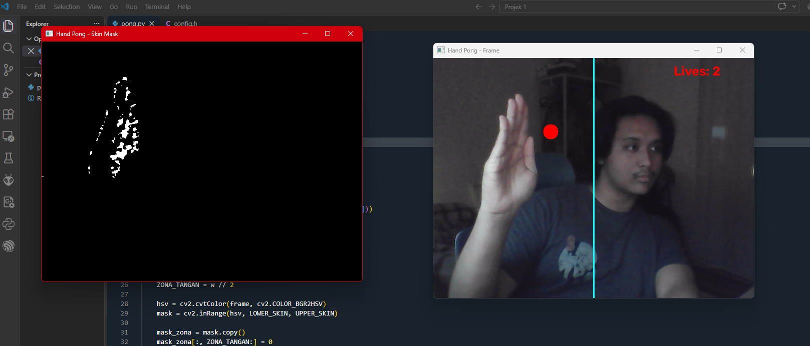

# Hand Pong - Mini Game Based on Hand Color
Projek Mata Kuliah Pengolahan Citra dan Video
Nama: Fauzian Ramadhan
NRP: 5024241080
## 1. Konsep Game
Hand Pong adalah adaptasi dari game klasik Pong berbasis interaksi visual (Computer Vision) tanpa menggunakan perangkat input fisik seperti mouse atau keyboard. 

  

## 2. Fitur
- Kontrol tanpa sentuhan menggunakan webcam
- Deteksi tangan berbasis warna kulit (HSV color thresholding)
- Zona deteksi terbatas di sisi kiri layar
- Arah pantulan bola bergantung pada posisi sentuhan tangan
- Sistem nyawa, game over, dan restart
- Jendela *Skin Mask* untuk memantau hasil deteksi secara real-time

## 3. Cara Kerja

Webcam - BGR ke HSV - inRange (mask kulit) - Batasi mask ke zona kiri - Update posisi bola - Cek tabrakan bola-tangan - Cek tabrakan dinding / gawang - Jika bola tabrak dinding pemain (kiri) nyawa mengurang

### 3.1 Segmentasi Warna Kulit (HSV)
Frame dikonversi dari BGR ke HSV, lalu cv2.inRange menghasilkan mask biner: piksel berwarna kulit menjadi putih, sisanya hitam. HSV dipilih karena komponen warna (Hue) terpisah dari kecerahan (Value), sehingga lebih tahan terhadap perubahan cahaya dibanding BGR.

### 3.2 Zona Tangan
Setengah kanan mask dikosongkan sehingga hanya tangan di sisi kiri yang dihitung.

mask_zona = mask.copy()
mask_zona[:, ZONA_TANGAN:] = 0

### 3.3 Fisika Bola
Bola bergerak dengan posisi += kecepatan tiap frame. Saat menyentuh dinding, kecepatan pada sumbu yang bersangkutan dibalik. Posisi bola dibatasi (*clamp*) agar tidak keluar dari frame.

### 3.4 Deteksi Tabrakan Bola dan Tangan
Area persegi di sekitar bola diambil dari mask_zona. Jika jumlah piksel putih (kulit) di area itu melebihi 30, dianggap terjadi sentuhan. Ambang batas ini berfungsi menyaring noise kecil pada mask.

## 4. Cara Menjalankan 
python pong.py

Dua jendela akan muncul:
- **Hand Pong - Frame**: tampilan game
- **Hand Pong - Skin Mask**: mask hasil deteksi kulit (area putih = terdeteksi)

## 5. Cara Bermain
- Duduk di depan webcam dengan pencahayaan yang cukup.
- Posisikan tangan di sebelah kiri garis cyan
- Gerakkan tangan untuk memukul bola agar tidak mengenai dinding kiri.
- Cek jendela skin mask : tangan harus terlihat putih dan pastikan wajah dan latar belakang tidak terdeteksi
- 'r' Restart game (nyawa dan bola di reset)
- 'q' keluar dari program
